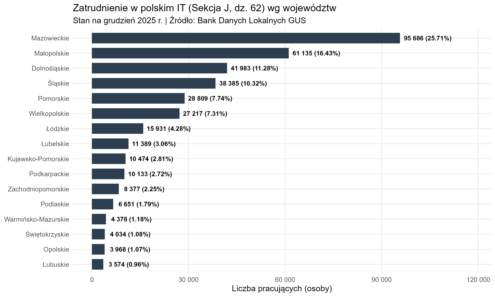
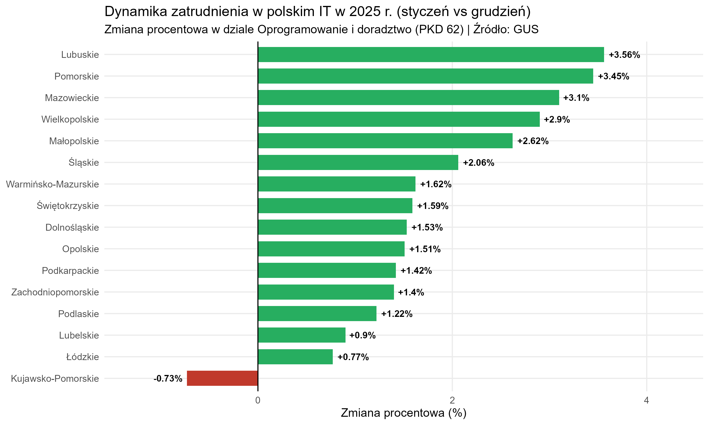
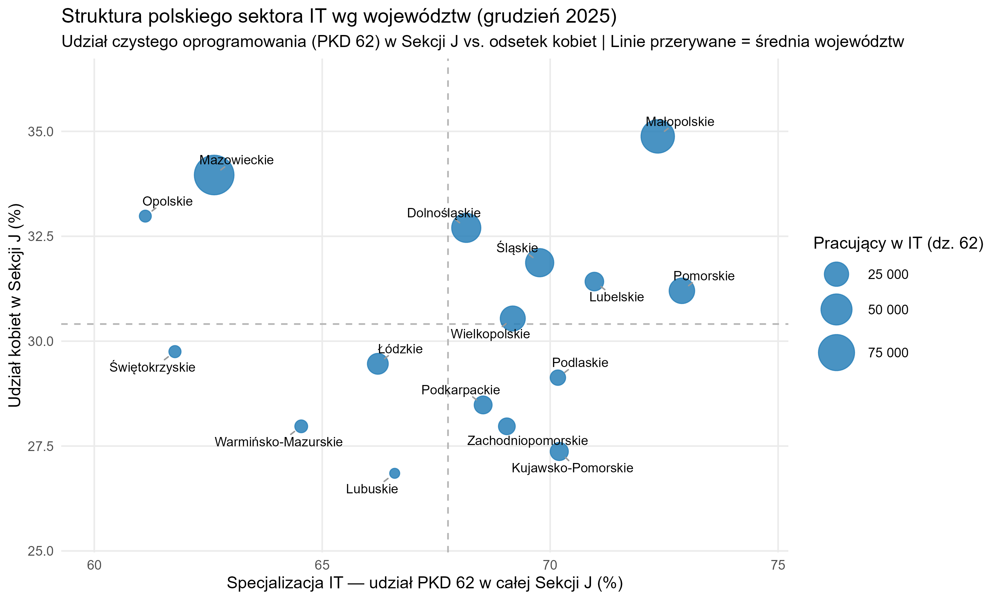
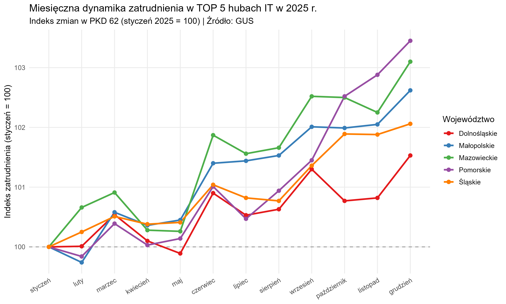
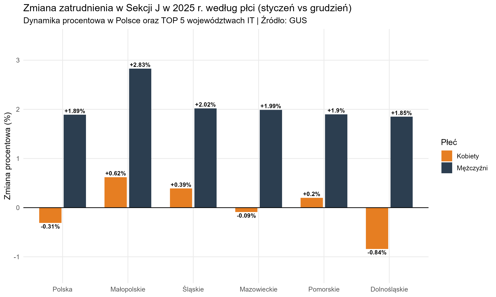

# Polish IT Labor Market in 2025 (R & Tidyverse)

An exploratory analysis of employment trends, regional concentration, and gender structure in the Polish IT sector during 2025. 

Instead of using synthetic datasets, I pulled official monthly statistics from **Statistics Poland (GUS – Local Data Bank)** covering **PKD Section J (Information and Communication)** and specifically **Division 62 (Computer programming, consultancy and related activities)**.

## What the Data Shows

* **Over half of Polish IT sits in 3 regions:** Mazowieckie (25.7%), Małopolskie (16.4%), and Dolnośląskie (11.3%) account for **53.4%** of all software & IT consultancy jobs in Poland. Top 6 regions hold nearly **79%** of the market.
* **Percentage growth vs. real job creation:** Small markets like Lubuskie (+3.56%) grew the fastest percentage-wise, but in absolute numbers, **Mazowieckie (+2,876 jobs)** and **Małopolskie (+1,562 jobs)** generated more than half of all new IT roles nationwide. **Kujawsko-Pomorskie** was the only region that shrank over the year (-77 jobs, -0.73%).
* **The Warsaw specialization gap:** Warsaw has the largest IT workforce, yet pure software development (`PKD 62`) makes up only **62.6%** of its Section J employment—well below Pomorskie (72.9%) or Małopolskie (72.4%). That's because Warsaw concentrates telecoms, TV stations, and media headquarters alongside tech companies.
* **Bigger hubs have more women in tech:** Female representation across Section J averages **30.4%** by region, but scales strongly with market size ($r = 0.72$)—peaking in Małopolskie (34.9%) and Mazowieckie (34.0%), while staying lowest in Lubuskie (26.8%).
* **April 2025 dip across all major hubs:** Looking at month-by-month trends (`Jan 2025 = 100`), all top 5 IT regions saw a synchronized drop in headcount in April 2025 before bouncing back in the second half of the year.

## Charts

### 1. Where Polish IT Jobs Are Located (Dec 2025)

### 2. Winners and Losers of 2025 (Jan vs. Dec)

### 3. Software Specialization vs. Female Share by Region

### 4. Month-by-Month Trajectory in Top 5 Hubs

### 5. Men and women in IT sector 2025

## How It Was Built

* **Tools:** R, `tidyverse` (`readr`, `tidyr`, `dplyr`, `stringr`, `ggplot2`), `ggrepel`
* **Data wrangling:** Reshaped raw semicolon-delimited GUS exports from wide to long format (`pivot_longer`), fixed chronological month ordering via factors, joined two separate GUS tables (`left_join`) to calculate specialization ratios, and used window functions (`first`, `lag`) to track monthly index changes.

## Repository Files

* `sektor_it_2025.R` – full reproducible R script (ETL, calculations, and plots)
* `RYNEK_IT_2025.csv` – raw GUS employment data by voivodeship and PKD division
* `plec.csv` – raw GUS Section J employment data broken down by gender
* `*.png` – exported 300 DPI visualizations
